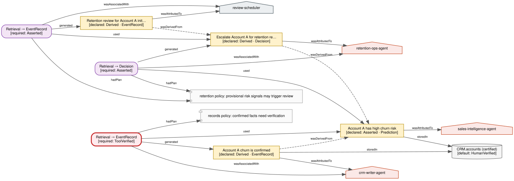

# claimprov

[](https://pypi.org/project/claimprov/)
[](https://github.com/smlee-tech/claimprov/actions/workflows/ci.yml)
[](https://doi.org/10.5281/zenodo.23907282)
[](LICENSE)

Claim-level provenance and epistemic status for multi-agent systems. A small extension of W3C PROV-O, SHACL shapes that enforce it, and (coming) middleware and an MCP server that apply it between agents.

**Status: pre-release (0.1.0a2).** The data model, ontology, shapes and a worked three-use scenario are in and tested. Storage/retrieval middleware and the MCP server are in progress. APIs will change before v0.1.0.

## Why this exists

AI agents now write interpretations into enterprise records: a churn score into a CRM field, a supplier classification into a procurement table, a lead-time estimate into a planning store. Another agent later retrieves the value and acts on it. Between those two steps something happens to the value's standing. The producing agent may have marked it *provisional*; the consuming agent treats it as *fact*. No one mislabeled anything. The qualification simply did not travel with the value.

claimprov is built around that observation. It distinguishes a claim's **declared** epistemic status (what the producer attached) from its **enacted** status (how a consumer actually used it), and it records both, so that the gap between production and reuse can be measured rather than assumed away.

It is the companion implementation of a working paper in information systems research. The paper supplies the theory; this library is the part that can be run. [docs/concepts.md](docs/concepts.md) has the full argument, the design decisions it forces, and what the code does and does not claim.

## What it does


*One provisional inference ("Account A has high churn risk", asserted) used three ways. Red: a consumer recorded it as a confirmed fact, which its policy says needs verification — status inflation. Not red: a consumer escalated for review under a policy that permits that on provisional evidence, and a scheduler recorded that the review happened. Same input, three records, three different justification conditions. Run `python examples/churn_three_uses.py`.*
- **Claims as the unit of governance.** Every proposition an agent puts into circulation is a `cp:Claim` with its own status, attribution, lineage, evidence and verifications: a representation at the grain at which agents actually reason, alongside asset-level governance (certified tables, semantic views).
- **A status lattice with teeth.** `asserted` = `derived` (rank 0) < `tool-verified` (1) < `human-verified` (2). Derivation adds lineage, not warrant; only a deterministic tool or a person can raise a claim's rank. SHACL shapes enforce the minimum evidence each status requires and reject *status laundering*: a claim declaring a higher rank than its sources without a verification of its own.
- **Retrieval as a provenance event.** `cp:Retrieval` records which agent took which claim, what kind of record it produced from it (`observedUse`), and what minimum status its acceptance policy required for that use (`requiredStatus`). The *enacted* status is derived from those, never annotated by hand. A use that required more warrant than was declared, with no review in between, is **status inflation**: a SHACL *warning*, not a violation. Using a provisional input for a purpose the policy permits on provisional evidence is not inflation.
- **Three kinds of record, three justification conditions.** A claim is a *prediction* (needs factual warrant), a *decision* (needs procedural legitimacy), or an *event record* (true iff it happened). One inference can produce all three downstream, and correcting the inference does not falsify the event record.
- **Assets carry a default standing.** A claim written into a certified asset without matching status is read, by anything that reads the asset rather than the claim, at the asset's standing. `cp:Asset` + `cp:defaultStatus` make that inheritance visible.

## Status lattice

| status | trust rank | requires |
|---|---|---|
| `asserted` | 0 | attribution to an agent |
| `derived` | 0 | at least one source claim via `prov:wasDerivedFrom` |
| `tool-verified` | 1 | a passed `cp:Verification` by a `cp:Tool` (or person) citing evidence |
| `human-verified` | 2 | a passed `cp:Verification` by a `prov:Person` citing evidence |

## Quickstart

Requires Python 3.10+.

```bash
pip install --pre claimprov        # pre-release from PyPI
# or, for development:
pip install -e ".[dev]" && pytest
```

```python
from claimprov import (AgentRef, AgentKind, Claim, ClaimGraph,
                       EpistemicStatus, RecordKind, RetrievalEvent)

analyst = AgentRef(kind=AgentKind.LLM_AGENT, name="analysis-agent", model="claude-sonnet-4-5")
planner = AgentRef(kind=AgentKind.LLM_AGENT, name="planning-agent", model="claude-sonnet-4-5")

c = Claim(statement="Supplier S-17 average lead time is 14 days",
          declared_status=EpistemicStatus.ASSERTED, asserted_by=analyst)

g = ClaimGraph()
g.add_claim(c)
# The planner wrote an event record ("lead time confirmed") from the claim.
# Its policy requires tool-verified input for event records.
g.add_retrieval(RetrievalEvent(claim_id=c.id, retrieved_by=planner,
                               observed_use=RecordKind.EVENT,
                               required_status=EpistemicStatus.TOOL_VERIFIED))

report = g.validate()
report.conforms        # True: nothing stored is malformed
report.warnings        # one: status inflation — the use required rank 1, the claim declares rank 0
print(g.serialize())   # PROV-O Turtle
```

## Layout

```
src/claimprov/
  model.py              Claim, RecordKind, EpistemicStatus, StatusPolicy, Asset, AcceptancePolicy,
                        Evidence, Verification, RetrievalEvent (pydantic)
  rdf.py                ClaimGraph: model → PROV-O graph; SHACL validation
  ontology/claimprov.ttl   the PROV-O extension
  ontology/shapes.ttl      the shapes (violations at storage, warnings at retrieval)
docs/concepts.md        theory, design decisions, scope
examples/               churn_three_uses.py (the scenario above), sample_graph.ttl, render_graph.py
tests/
```

## Roadmap to v0.1.0

- Storage and retrieval middleware for LangGraph-style agent chains.
- Correction propagation: what a corrected inference does, and does not do, to the records derived from it.
- MCP server: `record_claim`, `get_claim_status`, `check_retrieval`.

## Scope

This is a reference implementation of a theoretical distinction: it formalizes definitions precisely enough that they can be checked against scenarios, and it shows where they discriminate. It is not a detection product, not a safety layer, and not empirical evidence that the theory is right: a tool built from a definition will of course output that definition. The scenarios in `examples/` are illustrations and boundary cases, not findings. It uses no proprietary data and makes no claim about any vendor's behavior.

## Citing

See [CITATION.cff](CITATION.cff). Archived on Zenodo: concept DOI [10.5281/zenodo.23907282](https://doi.org/10.5281/zenodo.23907282) (all versions). A citation for the companion paper will be added when a public version exists.

## License

Apache-2.0